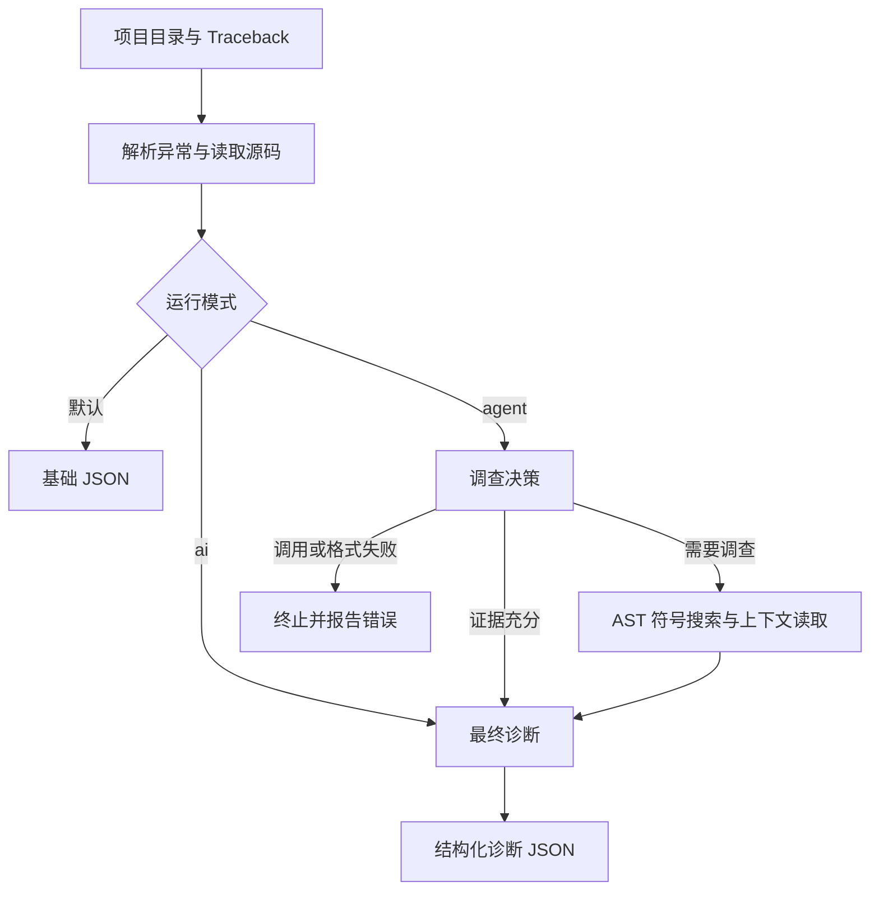

# RepoMedic

面向 Python 项目的错误诊断 CLI：输入项目目录和 Traceback，定位源码，由 LLM 按需调查相关函数或类，再输出有源码证据的诊断建议。

项目当前实现 V1：基础分析、单次 AI 诊断、最多一轮调查的 LangGraph Agent。工具只读取文件、解析 AST，不执行被分析项目，也不自动修改代码。真实模型效果尚未做系统评测，诊断结论需要开发者验证。

## 快速开始

需要 Python 3.11+。

```powershell
git clone https://github.com/jinqiu06/RepoMedic.git
cd RepoMedic
python -m venv .venv
.venv\Scripts\python -m pip install -r requirements.txt
# 离线演示，不需要 API Key
.venv\Scripts\python -m repomedic --project-root examples/demo --traceback-file examples/demo/traceback.txt
```

macOS / Linux 环境中，将 `.venv\Scripts\python` 替换为 `.venv/bin/python`。

## 运行模式

| 模式 | 参数 | 行为 | 是否需要模型服务 |
| --- | --- | --- | --- |
| 基础分析 | 无 | 解析异常并读取报错位置附近源码 | 否 |
| AI 诊断 | `--ai` | 根据已有异常和源码生成一次诊断 | 是 |
| Agent 调查 | `--agent` | 先判断是否需要补充证据，按需搜索定义后生成诊断 | 是 |

两个必填参数分别为 `--project-root`（待分析项目根目录）和 `--traceback-file`（UTF-8 编码的 Traceback 文件）。可通过 `python -m repomedic --help` 查看帮助。

## 模型配置

AI 模式使用兼容 ChatOpenAI 的服务，配置环境变量：

```powershell
$env:LLM_API_KEY = "your-key"
$env:LLM_MODEL_ID = "your-model"
$env:LLM_BASE_URL = "https://your-provider.example/v1"
.venv\Scripts\python -m repomedic --project-root examples/demo --traceback-file examples/demo/traceback.txt --ai
.venv\Scripts\python -m repomedic --project-root examples/demo --traceback-file examples/demo/traceback.txt --agent
```

也可以在 `repomedic/.env` 中配置上述三个变量；不要提交凭据。`--ai` 与 `--agent` 互斥。AI 模式会向配置的服务发送经过规则脱敏的错误信息和相关源码，请在有权发送源码的项目中使用。

## 输出格式

结果以 JSON 写入标准输出，错误写入标准错误。

| 字段 | 内容 | 适用模式 |
| --- | --- | --- |
| `error_type` / `message` | 异常类型和错误信息 | 全部 |
| `file_path` / `line_number` / `function` | 最后一个 Traceback 栈帧的位置 | 全部 |
| `source_context` | 文件路径、起止行号和源码行；不可读取时为 `null` | 全部 |
| `ai_diagnosis` | 根因、证据、修复建议、验证步骤与局限 | AI / Agent |
| `investigation` | 调查决策、符号匹配、新增上下文和工具告警 | Agent |

`ai_diagnosis` 的字段包括 `status`、`root_cause`、`evidence`、`suggested_fix`、`verification_steps`、`limitations`。证据不足时可返回 `status: "insufficient_context"`。

| 退出码 | 含义 |
| --- | --- |
| 0 | 分析流程完成，诊断是否充分需查看 `status` |
| 1 | 无法从 Traceback 中定位异常 |
| 2 | 参数、路径或输入文件无效 |
| 3 | 模型配置、调用、输入大小或响应格式失败 |

## 工作流与模块



| 模块 | 职责 |
| --- | --- |
| `traceback_parser` / `source_reader` / `error_analyzer` | 确定性解析、项目边界校验、源码上下文 |
| `code_search` | AST 搜索函数、异步函数和类，排除依赖与缓存目录 |
| `security` / `prompt_builder` | 递归脱敏、字段白名单、不可信输入隔离提示、输入大小限制 |
| `llm_models` / `llm_client` / `config` | Pydantic 输出校验、模型调用与延迟初始化 |
| `agent_nodes` / `agent_graph` / `agent_state` | 决策、工具调查、最终诊断与条件路由 |
| `cli` | 参数校验、模式选择、JSON 与退出码 |

## 资源与安全边界

- 最多一次调查决策、一次最终诊断，每次决策最多三个合法且不重复的 Python 标识符；每个符号最多两个匹配位置，每处读取前后五行。SDK 配置最多一次重试，因此 HTTP 请求次数可能多于逻辑调用次数。
- Traceback 和单个源码文件上限为 1 MiB；每次模型输入的数据 JSON 上限为 16 KiB。超过限制直接报错，不静默截断证据。
- 源码读取使用解析后的路径检查，拒绝项目目录外的文件；搜索跳过符号链接。不会 import 或运行目标代码。
- 新增调查证据与原始上下文统一经过规则脱敏。规则覆盖常见带引号的密钥赋值和 Bearer Token，并非完整的数据防泄漏系统；本地 JSON 仍可能包含源码与敏感信息。
- AST 搜索当前会扫描项目中的合格 Python 文件，没有总文件数或总时间预算；不适合直接用于超大仓库。并发修改文件时也不提供文件系统沙箱级保证。
- 符号搜索为定义名称精确匹配，不支持完整调用图或别名解析。源码窗口可能不覆盖整个函数。提示词隔离不能保证完全防住提示注入，诊断也不代表修复已验证。

## 测试与演示

```powershell
.venv\Scripts\python -m pytest -q
```

测试使用临时项目和 Mock 模型，不调用付费服务，覆盖基础解析、目录边界、提示词校验、AST 搜索、Agent 两条成功路由与失败终止。CI 在 Windows / Linux、Python 3.11 / 3.12 上运行；以实际 CI 结果为准。

演示项目位于 `examples/demo`：`greet()` 对 `load_user()` 的返回值进行下标访问，而 `load_user()` 返回 `None`，触发 `TypeError`。随附的 `traceback.txt` 可直接用于上述命令，无需运行目标项目。Agent 可根据决策搜索 `load_user` 的定义，并将其源码作为补充证据；是否发起该调查取决于实际模型输出。

## 已知限制

- 当前解析器提取最后一个栈帧和末行异常信息，没有完整建模异常链或 ExceptionGroup。
- 尚未提供自动修复、修复验证、多轮调查或 Web 界面。
- 模型需支持结构化输出所使用的 function calling；服务兼容性和诊断质量需按实际配置验证。
- 依赖版本尚未完全锁定，安装时应在独立虚拟环境中运行测试确认兼容性。
